<!--
  This README is generated by scripts/build.py from scripts/content.py.
  Edit the content file and run `python scripts/build.py`; the daily workflow does the same.
-->

  

  &nbsp;
  &nbsp;
  





<a href="https://github.com/MJforti/Prompt-Injection"></a>

<a href="https://github.com/MJforti/invoice-digitizer"></a>

<a href="https://github.com/MJforti/Sampatti"></a>

<a href="https://github.com/MJforti/Bahubali-Stock-Management"></a>

<a href="https://github.com/MJforti/xTag-v1-ETHGlobal"></a>

Live: &nbsp;<a href="https://contextshield-iota.vercel.app">ContextShield</a> &nbsp;·&nbsp; <a href="https://sampatti-one.vercel.app">Sampatti</a> &nbsp;·&nbsp; <a href="https://bahubali-stock-management.vercel.app">Bahubali Stock</a>


<picture>
  <source media="(prefers-color-scheme: dark)" srcset="./assets/generated/snake-dark.svg" />
  <source media="(prefers-color-scheme: light)" srcset="./assets/generated/snake-light.svg" />
  
</picture>

<a href="https://www.linkedin.com/in/mjf0rti"></a>

Every card here is a hand-built SVG, re-rendered daily by GitHub Actions. &nbsp;<a href="./scripts/content.py">Edit the content</a>

